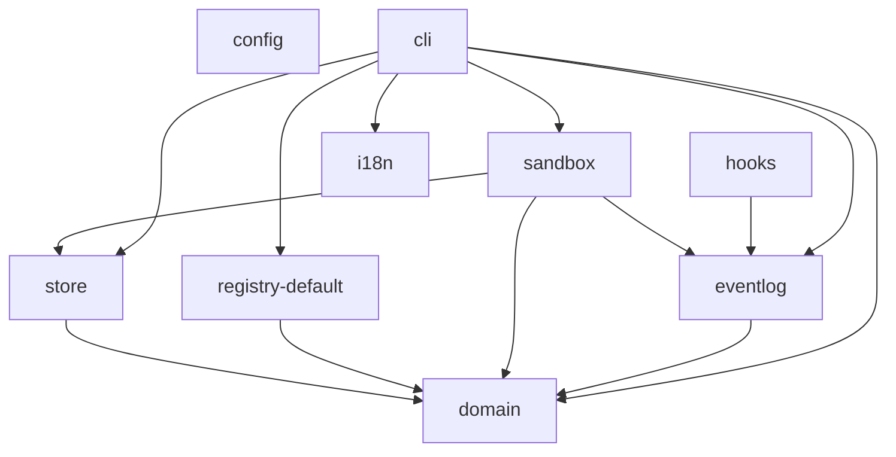

# Đồ thị phụ thuộc giữa các workspace

> Sinh từ import thật của mã chạy (dependency-cruiser; bỏ test, fixture, file cấu hình) và `packages/config/boundaries.mjs` bằng `pnpm docs:gen`, CI kiểm drift: sửa nguồn rồi chạy lại lệnh, không sửa file này.

Mũi tên `A --> B`: mã chạy của A import B (kể cả `import type`). Bảng cho phép là luật ở [implementation-plan.md](implementation-plan.md) §1.3; ESLint và `pnpm boundaries` chặn mọi import ngoài bảng (ADR 0001).

| Workspace | Thư mục | Import thật | Được phép (`boundaries.mjs`) |
|---|---|---|---|
| `config` | `packages/config` | — | — (chỉ dùng khi dev) |
| `domain` | `packages/domain` | — | — |
| `store` | `packages/store` | `domain` | `domain`, `eventlog` |
| `registry-default` | `packages/registry-default` | `domain` | `domain` |
| `runner-core` | chưa có | | `domain`, `store`, `eventlog` |
| `runner-claude` | chưa có | | `runner-core` |
| `runner-antigravity` | chưa có | | `runner-core` |
| `runner-gemini` | chưa có | | `runner-core` |
| `runner-codex` | chưa có | | `runner-core` |
| `steward` | chưa có | | `domain`, `store`, `eventlog`, `runner-core` |
| `chancellor` | chưa có | | `domain`, `runner-core` |
| `sandbox` | `packages/sandbox` | `domain`, `eventlog`, `store` | `domain`, `eventlog`, `store` |
| `eventlog` | `packages/eventlog` | `domain` | `domain` |
| `hooks` | `packages/hooks` | `eventlog` | `eventlog` |
| `herald` | chưa có | | `domain`, `store`, `eventlog`, `sandbox` |
| `i18n` | `packages/i18n` | — | — |
| `ui-kit` | chưa có | | — |
| `ui` | chưa có | | `domain`, `i18n`, `ui-kit` |
| `world` | chưa có | | `domain`, `i18n`, `ui-kit`, `ui` |
| `lite` | chưa có | | `domain`, `i18n`, `ui-kit`, `ui` |
| `cli` | `apps/cli` | `domain`, `eventlog`, `i18n`, `registry-default`, `sandbox`, `store` | `domain`, `eventlog`, `store`, `registry-default`, `runner-core`, `runner-claude`, `runner-antigravity`, `runner-gemini`, `runner-codex`, `hooks`, `steward`, `chancellor`, `sandbox`, `herald`, `i18n` |
