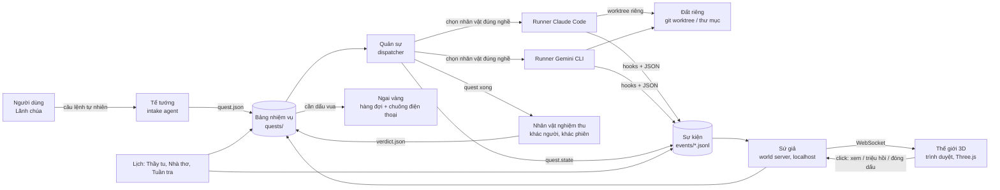

# Kế hoạch dựng Elvaria

Ngày: 2026-11-10 · Phiên bản 0.8 (0.7 + tự cường: thế giới tự đo, tự học, tự lập kế hoạch và tự dựng các giai đoạn sau của mình; thư có kiểu giữa các nhân vật; tính cách; Quản sự giao hàng tới merge). Phần mới nằm ở mục 14; các mục 1, 2, 4–7, 10–12 sửa theo và ghi "(0.8)" ở chỗ sửa.

**Elvaria** là tên sản phẩm và repo. Mỗi người dùng tự đặt tên vương quốc của mình khi mở lần đầu và tên từng lãnh địa khi gắn dự án (mặc định là tên repo).

---

## 1. Tóm tắt

Elvaria là một thế giới fantasy low-poly 3D chạy trên máy cá nhân (Windows và macOS), trong đó mỗi AI agent là một nhân vật có nghề: nhận việc thật từ bảng nhiệm vụ, làm, được nhân vật khác nghiệm thu, và giao ra code, tài liệu, nghiên cứu thật. Thế giới là giao diện quản lý, không phải trang trí bên cạnh giao diện quản lý.

Một vương quốc = một người dùng = một máy. Developer, BA, marketing, researcher dùng cùng một thế giới nhưng sống ở những khu khác nhau của nó. Không có server chung, không đồng bộ giữa các máy.

Tiêu chí thành công của bản v1:

- Nói một câu với Tể tướng → quest đúng dạng xuất hiện trên bảng, nhân vật đúng nghề tự nhận và làm.
- Mọi quest xong đều qua nghiệm thu của một nhân vật khác, phiên khác; không có "tự làm tự chấm".
- Hết mana không mất việc: đăng nhập lại là nhân vật tỉnh dậy và làm tiếp từ journal.
- Thế giới nhàn rỗi dùng dưới 5% CPU; để cạnh VS Code cả ngày không nóng máy.
- Biên niên sử mỗi tối đọc được như một báo cáo ngày.
- Mở trên điện thoại từ xa: thấy việc cần duyệt, đóng dấu, ra lệnh cho Tể tướng — máy ở nhà làm tiếp.
- (0.8) Giao một việc lớn bằng vài câu → một kế hoạch đã có người khác duyệt, một lần đóng dấu; sau đó thế giới tự chạy tới khi giao hàng, người dùng chỉ gặp bản tấu mỗi ngày và dấu vua.
- (0.8) Lỗi lặp giảm thấy được trên sổ đo, và Elvaria dựng được các giai đoạn sau của chính nó bằng đúng quy trình đó (mục 14).

---

## 2. Nguyên tắc nền

Mười bảy điều không đổi trong suốt dự án (1–13 có từ bản 0.4, giữ nguyên chữ; 14–17 thêm ở bản 0.8). Mọi quyết định thiết kế sau này phải đối chiếu với danh sách này.

1. **Ba tầng tách biệt.** Tầng việc (work engine) – tầng sự kiện (event bus) – tầng thế giới (renderer). Renderer chỉ *nghe* sự kiện, không bao giờ gọi ngược vào tầng việc. Thay toàn bộ hình ảnh mà không đụng logic.
2. **Local-first.** Một máy là một vương quốc. Trạng thái là file trong một thư mục. Không tài khoản, không server, không realtime liên máy.
3. **Trạng thái việc nằm ngoài phiên agent.** Nhân vật có thể chết bất cứ lúc nào (hết mana, crash, tắt máy) mà không mất việc. Journal của quest là nguồn sự thật, không phải trí nhớ phiên chat.
4. **Người làm không phán.** Nghiệm thu luôn do nhân vật khác, phiên mới, chưa thấy quá trình làm; ưu tiên khác nhà cung cấp (Claude làm thì Gemini duyệt và ngược lại).
5. **Mỗi nhân vật một nghề.** Không kiêm nhiệm. Thiếu người thì triệu hồi thêm, không ép hiệp sĩ đi chép sách.
6. **Mana là hạn mức; mỗi tộc một tài khoản của người dùng.** Khởi đầu là Claude Code + Gemini; thêm tộc (Codex, API thuần…) là thêm một adapter theo hợp đồng tộc và một tài khoản người dùng tự đăng nhập. Hệ thống không bao giờ tự xoay tài khoản; hồi sinh là việc của người dùng. Thế giới dùng tới trần người dùng đặt (mặc định 98%) nhưng luôn chừa **phần của vua**.
7. **Ánh xạ là dữ liệu.** Dạng nhiệm vụ → tòa nhà, hoạt hình, nghi thức nằm trong file theme. Đổi theme không sửa lõi.
8. **Nhẹ là luật, không phải mục tiêu.** Vẽ khi có thay đổi; trần 30 fps; tab ẩn thì dừng.
9. **Mọi thứ nhìn được đều hỏi được.** Click nhân vật, tòa nhà, quái → thông tin thật và hành động thật.
10. **Sa bàn trước, sắc đẹp sau.** Logic chạy đúng trên hộp xám rồi mới tô.
11. **Tỉ lệ thật trong lãnh thổ, nén giữa các lãnh thổ.** Nhà đúng cỡ và vào được, núi leo được; đường giữa các vùng rút ngắn, một chuyến đi không quá 20 giây.
12. **Thế giới mọc dần.** Gắn repo là mở cõi. Quốc vương phải thấy được tất cả, nên mọi thứ xa camera đều có dạng rút gọn, và luôn có một lớp "cần ngài" nói việc gì đang chờ.
13. **Một quest, một context.** Mỗi nhân vật là một phiên cấp cao nhất mới, nạp đúng phần cần từ journal, kinh và địa chí; trí nhớ dài nằm trên đĩa, không nằm trong phiên. Tể tướng chia việc sao cho một quest xong trong một context; việc dài hơn thì chia, không kéo dài phiên. Cái gì máy làm được thì không gọi model.
14. **Học là phải đo.** Model không tự học sau khi phát hành; thế giới học bằng cách sửa những thứ quanh model: ngữ cảnh, quy trình, cách chọn người, công cụ. Mỗi bài học, bí kíp hay thay đổi prompt gắn với một phán quyết hoặc một số đo, và bị gỡ khi số đo không ủng hộ. Lỗi lặp thì sửa ở bậc cao nhất làm được: chặn bằng quyền, để máy kiểm, để script làm, rồi mới tới bí kíp, kinh và model mạnh hơn.
15. **Nhân vật không nói chuyện riêng.** Mọi trao đổi giữa các nhân vật là thư có kiểu, đi qua Quản sự và nằm trong event log. Quyết định chung nằm trong hợp đồng, không nằm trong trí nhớ của ai. Hai việc chạm cùng vùng file thì không chạy cùng lúc.
16. **Tính cách đổi giọng, không đổi việc.** Tính cách và quan hệ chỉ sống ở tầng hiển thị và ở lời nhân vật nói với người dùng. Quan hệ suy ra từ phán quyết, không bao giờ là đầu vào của phán quyết hay của việc chọn người. Nhân vật nào cũng báo tin xấu đúng như nó là.
17. **Người bị đo không sửa thước đo.** Luật tách vai, nghi thức, cầu dao, sổ đo và mọi thứ canh giữ thế giới nằm trong vùng bảo vệ: sửa được, nhưng chỉ qua dấu vua. Bản đang chạy của Quản sự chỉ đổi qua một bước nâng cấp có thử trước và có đường lùi.

---

## 3. Kiến trúc tổng thể



Thành phần và trách nhiệm:

| Thành phần | Tên trong thế giới | Làm gì | Công nghệ dự kiến |
|---|---|---|---|
| Intake agent | Tể tướng | Nhận câu lệnh tự nhiên, tách thành quest đúng dạng, ước lượng hạng và mana, hỏi lại tối đa một câu | Agent chạy bằng Claude (Sonnet), prompt + schema quest |
| Bảng nhiệm vụ | Hội quán | Lưu quest, trạng thái, journal, verdict | Thư mục file JSON + Markdown (SQLite khi cần truy vấn) |
| Dispatcher | Quản sự | Vòng lặp: chọn quest → chọn nhân vật → spawn runner → theo dõi cầu dao → chuyển sang nghiệm thu → giao hàng | Node.js hoặc Python, một tiến trình nền |
| Runner | Sứ giả triệu hồi | Mở phiên agent với prompt dựng từ quest + kinh + địa chí; chuẩn hóa output thành sự kiện | Gọi `claude` và `gemini` ở chế độ headless; script Node chạy y hệt trên Windows và macOS |
| Event log | Biên niên gốc | Mọi sự kiện, một dòng JSON, theo ngày | JSONL, append-only |
| World server | Sứ giả | Đọc event log, giữ world state, phục vụ renderer | Node.js, WebSocket, tĩnh trên localhost |
| Renderer | Thế giới | Góc nhìn Chúa, nhân vật, tòa nhà, nghi thức, trận đánh | Three.js + Vite, chạy trong trình duyệt |
| Verifier | Thợ cả, Thủ thư trưởng, Trọng tài, Hiền giả… | Chạy kiểm tra máy rồi chấm theo nghi thức của dạng nhiệm vụ | Nhân vật nghề nghiệm thu, giới "không làm" |
| Lịch | Thầy tu, Nhà thơ, Tuần tra | Phản tỉnh, biên niên sử, phát hiện vấn đề | Bộ lịch tích hợp trong Quản sự (không dựa vào cron hay Task Scheduler), model rẻ |
| Đường hầm (tùy chọn) | Cổng thành | Mở Sứ giả ra ngoài có xác thực để điện thoại hoặc máy khác xem và điều khiển | Tailscale hoặc Cloudflare Tunnel + token; khách nhẹ 2D cho điện thoại |

Luồng một quest từ đầu đến cuối:

1. Người dùng gõ lệnh → Tể tướng tạo `quests/<id>.json` (trạng thái `open`).
2. Quản sự thấy quest `open`, lọc nhân vật rảnh đúng nghề, đủ cấp, tộc còn mana, rồi xếp theo danh tiếng trên các tag của quest → `claimed`.
3. Runner tạo đất riêng (worktree cho code, thư mục cho tài liệu), dựng prompt (quest + journal + kinh + địa chí + tối đa 3 bí kíp khớp tag và lãnh thổ), mở phiên → `working`. Hooks ghi sự kiện; nhân vật trên bản đồ đi tới đúng tòa nhà.
4. Agent ghi journal theo mốc, nộp bài → `review`.
5. Quản sự chọn nhân vật nghiệm thu (khác người, khác phiên, ưu tiên khác tộc) → chạy kiểm tra máy → chấm theo nghi thức → `verdict`.
6. Đạt → `done`, giao hàng theo quy ước của dạng; cần dấu vua → `awaiting_seal` + chuông. Không đạt → `returned` kèm ghi chú, quay lại bước 3 với cùng nhân vật (tối đa N lần).
7. Tối: Nhà thơ đọc sự kiện ngày → `chronicle/<ngày>.md`.

---

## 4. Mô hình dữ liệu

### Quest

| Trường | Kiểu | Ghi chú |
|---|---|---|
| id, title, description | string | |
| kind | enum | 11 dạng ở mục 5 |
| rank | F, E, D, C, B, A, S | Tể tướng ước lượng, người dùng sửa được |
| class_required | string | nghề được nhận |
| tags | string[] | chuyên môn: frontend, backend, db, infra, i18n, e2e, docs… do Tể tướng gán; quyết định xếp hạng nhân vật và bí kíp được nạp |
| party_id, contract | id, path | thuộc đội nào; hợp đồng giữa các phần (ví dụ OpenAPI) nếu là quest con của đội |
| territory | id | dự án/thư mục |
| scope_paths | string[] | (0.8) vùng file quest được chạm, do Nghị hội hoặc Tể tướng khai; hai quest có vùng giao nhau không chạy cùng lúc; file ngoài vùng khi nộp bài là một tín hiệu cho người chấm (mục 14) |
| status | enum | open, claimed, working, review, returned, done, awaiting_seal, blocked, paused_mana, infirmary, archived |
| assignee, verifier | character id | verifier ≠ assignee, luôn |
| campaign_id, parent_id | id | thuộc chiến dịch / quest cha |
| budget | {max_minutes, max_tokens, max_attempts} | cầu dao |
| attempts | number | |
| journal | path | `quests/<id>/journal.md` |
| deliverable | {type, path hoặc branch} | quy ước giao hàng theo dạng |
| seal_required | boolean | |
| created_at, updated_at | ISO | |

### Character

| Trường | Ghi chú |
|---|---|
| id, name | |
| class | nghề (mục 6) |
| provider | claude hoặc gemini |
| model | tier hiện tại |
| level | 1–10 |
| gear_tier | 1–4, suy từ cấp (1–3, 4–6, 7–9, 10); quyết định trang bị hiển thị |
| reputation | {pass, fail, human_pass, human_fail, window[]} |
| skill_affinity | {tag: {pass, fail, window[]}} — danh tiếng theo từng tag, tự tích lũy; nguồn của chuyên môn |
| title | danh hiệu hiện trên đầu, sinh từ tag có danh tiếng cao nhất (hoặc người dùng ghim) |
| status | idle, working, reviewing, sleeping_mana, meditating, suspended, swamp |
| scripture | path `characters/<id>/scripture.md` (kinh riêng) |
| vow_no_production | true cho nghề nghiệm thu và thầy tu |
| persona | (0.8) {address: cách xưng hô, tone: giọng, verbosity: độ dài lời, quirks[]: vài nét riêng}; chỉ dùng cho lời nói với người dùng và tầng hiển thị. Tâm trạng và quan hệ với nhân vật khác suy ra từ lịch sử, không lưu (mục 14) |

### Territory

| Trường | Ghi chú |
|---|---|
| id, name, path | repo hoặc thư mục |
| kind | code, docs, content, data, mixed |
| gazetteer | path `territories/<id>/gazetteer.md` (địa chí: cấu trúc, cách build, quy ước) |
| buildings[] | sinh từ khảo sát điền địa: module → tòa nhà, test → tường, docs → kệ |
| health | {ci, open_bugs, last_patrol} → thời tiết |
| worktrees[] | lều trại đang mở |
| map_anchor, bounds | vị trí và ranh giới trên bản đồ, sinh khi mở cõi |
| lod | full, reduced, icon — theo khoảng cách camera và số lãnh thổ đang mở |
| protected_paths | (0.8) vùng bảo vệ: quest chạm vào đây luôn cần dấu vua (nguyên tắc 17) |
| shared_paths | (0.8) file nóng mà nhiều quest cùng sửa (bảng thuật ngữ, file sinh…), kèm cách ghép: sinh lại bằng lệnh của lãnh thổ, hay giữ cả hai phía |
| delivery | (0.8) `manual` (như giai đoạn 1: người dùng merge tay), `pr` (Quản sự push nhánh và mở PR), `pr_merge` (thêm merge khi CI xanh); mặc định `manual` |

### Campaign (Chiến tranh)

| Trường | Ghi chú |
|---|---|
| id, name, mode | offense (release, launch, epic) hoặc defense (sự cố) |
| fronts[] | mỗi mặt trận: tên, mục tiêu, quest_ids[] |
| victory_conditions[] | điều kiện kiểm tra được |
| morale | tỉ lệ hoàn thành / thời gian còn lại |
| status | declared, active, won, lost, retro_pending, closed |
| retro | path hội đồng sau chiến |

### Verdict

| Trường | Ghi chú |
|---|---|
| quest_id, attempt, verifier_id | |
| ritual | nghi thức của dạng (mục 5) |
| checks[] | kết quả kiểm tra máy: tên, pass/fail, log |
| result | pass, fail |
| notes | ghi chú trả bài, cụ thể, có thể hành động |
| by_human | true nếu là dấu vua |

### Lesson (một dòng kinh)

| Trường | Ghi chú |
|---|---|
| id, owner | character id hoặc `temple` |
| text | một câu, mệnh lệnh |
| source_verdict | bắt buộc: bài học phải bắt nguồn từ phán quyết |
| created_at, last_hit_at, retired_at | thanh lọc sau 3 mùa không chạm |
| scope | (0.8) nơi bài học được đo: tộc, hệ điều hành, phiên bản CLI, lãnh thổ, tag; ngoài phạm vi đó thì không nạp |
| helped, missed | (0.8) số lần chạy có nạp bài học mà lỗi tương ứng không xảy ra / vẫn xảy ra; căn cứ để giữ hay gỡ |

### Skill (bí kíp)

| Trường | Ghi chú |
|---|---|
| id, title | |
| tags[] | tag quest mà bí kíp này áp dụng |
| scope | `global` hoặc id lãnh thổ |
| path | `temple/skills/<id>/SKILL.md` + file kèm; runner chuyển sang định dạng skill của từng CLI khi nạp vào worktree |
| source | `temple` (thầy tu viết từ bài học lặp) hoặc `user` |
| max_tokens | trần kích thước; bí kíp dài quá thì chia |

### Letter (thư, 0.8)

| Trường | Ghi chú |
|---|---|
| id, kind | `proposal` (việc ngoài phạm vi), `advisory` (tôi đổi thứ vùng khác dùng), `request` (tôi cần thứ ở vùng khác), `objection` (không phục phán quyết); từ vựng đóng |
| from, quest | nhân vật viết và quest đang làm; nhân vật viết thư trong thư bàn giao, Quản sự là người lập thư |
| to | do Quản sự định tuyến theo kind: Tể tướng, các quest có vùng file liên quan, người chấm thứ hai, hoặc người dùng |
| body, refs[] | một việc một thư; `refs` là đường dẫn file hay id quest |
| state | filed, routed, closed; kèm kết quả (gộp vào quest nào, mở quest nào, gác lại, người dùng quyết gì) |

### Event

```json
{"ts":"2026-11-06T09:12:03+07:00","type":"agent.tool","character":"thorn","quest":"q_0142","territory":"shop-api","data":{"tool":"Edit","path":"src/auth/login.ts"}}
```

Các loại sự kiện chính: `quest.created / claimed / started / submitted / returned / done / sealed / paused / infirmary`, `agent.tool` (read, write, bash, search, web), `agent.subagent.spawn / end`, `agent.compact`, `verdict.pass / fail`, `mana.level / exhausted / restored`, `character.sleep / wake / meditate / suspend`, `campaign.declared / front.update / won / lost / retro`, `battle.start / unit.down / unit.fall / wounded / end`, `incident.alarm / cleared`, `patrol.rumor`, `delivery.sent`, `chronicle.written`. (0.8) Thêm: `letter.filed / routed / closed`, `delivery.pushed / merged / failed`, `digest.written`, `lesson.added / retired`, `upgrade.started / switched / rolled_back`.

### Bố cục thư mục

```
kingdom/
  kingdom.json               # tên vương quốc, nghề người dùng, cài đặt, mana_cap, king_reserve, lịch bật/tắt
  territories/<id>/          # territory.json, gazetteer.md
  quests/<id>.json
  quests/<id>/journal.md     # journal, ghi chú trả bài, thư bàn giao
  characters/<id>/           # character.json, scripture.md
  campaigns/<id>.json
  verdicts/<quest>-<n>.json
  events/YYYY-MM-DD.jsonl
  chronicle/YYYY-MM-DD.md
  temple/scripture.md        # kinh chung
  temple/skills/<id>/        # bí kíp: SKILL.md + file kèm, nạp theo tag
  temple/exemplars/<loại>/   # (0.8) bài mẫu người dùng ưng, theo loại tài liệu
  letters/<id>.json          # (0.8) thư giữa các nhân vật, do Quản sự lập
  digest/YYYY-MM-DD.md       # (0.8) bản tấu: mọi việc cần người dùng trong ngày, mỗi việc kèm khuyến nghị
  training/                  # (0.8) thao trường: quest mẫu từ lịch sử và kết quả các lần thử
  world/map.json             # địa hình, vị trí lãnh thổ, tòa nhà
  world/themes/fantasy/      # kinds.json, classes.json, rituals.json, assets/
```

---

## 5. Dạng nhiệm vụ và nghi thức nghiệm thu

Mọi việc thật của mọi nghề rơi vào một trong 11 dạng. Mỗi dạng có nơi chốn, hành động, nghi thức và quy ước giao hàng riêng. Chiến tranh là vật chứa, không phải dạng lá.

| Dạng | Việc thật | Nơi trên bản đồ | Nghi thức nghiệm thu | Kiểm tra máy đi kèm | Giao hàng |
|---|---|---|---|---|---|
| **Kiến tạo** | Feature, trang, slide, thiết kế, bộ cấu hình mới | Công trường, xưởng, họa thất | *Thợ cả khám công trình*: chất tải, nứt thì vá; đạt thì lễ khánh thành | test, lint, build, type-check | Nhánh/PR (code); file vào thư mục đã định |
| **Thám hiểm** | Nghiên cứu công nghệ, khảo sát thị trường, điều tra đối thủ | Vùng sương mù | *Đánh sinh vật canh giữ*: Rồng (câu hỏi lớn), Hydra (nhiều đầu), Sphinx (phải chính xác); thua thì về lấy thêm chứng cứ | kiểm tra nguồn còn sống, số liệu có trích dẫn | Báo cáo vào thư viện; vùng sáng lên trên bản đồ |
| **Trừ tà** | Bug, lỗi dữ liệu, link chết, số sai trong báo cáo | Nơi việc hỏng, quái xuất hiện tại chỗ | *Săn và đặt bẫy*: giết quái chưa đủ, phải đặt bẫy và chờ một đêm | regression test mới + toàn bộ test cũ | PR sửa lỗi kèm test |
| **Gia cố** | Refactor, tối ưu, biên tập lại, dọn backlog | Tường thành, lò mài | *Thử bão*: chịu stress test / benchmark / so sánh trước–sau | benchmark, test, diff số liệu | PR + bảng trước/sau |
| **Soạn thảo** | Tài liệu, spec, BRD, SOP, hợp đồng nháp | Phòng chép sách | *Thủ thư trưởng duyệt bản thảo*: đối chiếu, gạch chỗ sai, đóng gáy | kiểm tra link, mục lục, thuật ngữ nhất quán | File vào thư viện (md/docx) |
| **Rao truyền** | Blog, post, email chiến dịch, thông cáo | Quảng trường | *Dân chúng phản ứng*: nhà thơ hát thử, đám đông chấm theo checklist giọng điệu/thương hiệu | độ dài, từ cấm, link UTM | Bản nháp chờ dấu vua trước khi đăng |
| **Chiêm nghiệm** | Phân tích số, dashboard, A/B test, báo cáo tuần | Đài thiên văn | *Chiêm tinh gia thứ hai tính lại* từ dữ liệu gốc; khớp thì khắc lên bia | chạy lại script, so khớp số | Báo cáo + dữ liệu gốc + script |
| **Nghị hội** | Kế hoạch sprint, chia epic, chọn giải pháp, phân tích yêu cầu | Phòng hội đồng | *Hội đồng biểu quyết*: 2–3 agent phản biện, đủ phiếu mới ban chiếu | kiểm tra mọi quest con có hạng, nghề, mana | Danh sách quest con lên bảng |
| **Chinh phục** | Tích hợp API ngoài, migrate, tiếp quản legacy, đưa công cụ mới vào, mở thị trường, thắng khách hàng | Pháo đài có cờ lạ | *Lập đồn và cắm cờ*: vây hãm → đoạt → đồn trú; giữ được qua một mùa mới tính | chạy ổn N ngày, có docs, có người phụ trách, hệ cũ đã tháo | Tích hợp + địa chí cập nhật |
| **Ngoại giao** | Đàm phán vendor, xin phê duyệt stakeholder, phối hợp đối tác | Sứ quán | *Ký hiệp ước*: hai bên xác nhận bằng văn bản | — | Bản nháp thư/điều khoản; người dùng gửi |
| **Trận đánh** | Bầy việc nhỏ (triage 80 issue, 200 file, 40 test vỡ, load test) hoặc đối kháng (red/blue team, bake-off, tranh luận, so sánh cạnh tranh) | Chiến trường | *Điểm quân sau trận*: xác quái = xong, bia mộ = chưa xong, thương binh = chờ người, đổ nát = nợ tạo ra | từng đơn vị có pass/fail riêng; trọng tài cho đối kháng | Báo cáo trận + quest Gia cố tự sinh cho đổ nát |
| **Chiến tranh** (vật chứa) | Release lớn, launch, epic, deadline; phòng thủ: sự cố, lỗ hổng, khủng hoảng | Phòng chiến sự | *Tuyên bố chiến thắng* khi mọi mặt trận đóng, rồi *hội đồng sau chiến* (retro/postmortem) | điều kiện chiến thắng kiểm tra được | Chiếu bài học → kinh chung |

Nghi thức là **dữ liệu** trong `world/themes/fantasy/rituals.json`: tên, các bước, hoạt hình, điều kiện đạt. Thêm dạng mới = thêm một dòng ở đây và một tòa nhà.

### Test trong thế giới

Ba thứ khác nhau, ba cách xử lý:

- **Chạy test không phải quest.** Là kiểm tra máy trong nghi thức, bậc script, 0 mana. Unit chạy ở mọi quest; integration và e2e (cần Docker) chạy **một lần ở quest ghép** của đội, không chạy ở từng quest con.
- **Test đi kèm thay đổi do người làm tự viết**, trong cùng quest — là bằng chứng của thay đổi, nằm trong Definition of Done. Người chấm chấm cả hai.
- **Test là sản phẩm riêng** ("viết e2e cho luồng X", "integration cho guard Y") là quest Kiến tạo/Gia cố với tag `e2e` / `integration`, người viết và người chấm khác nhau như mọi quest, nhưng dùng nghi thức riêng dưới đây. Không có nghề "tester": viết test là viết code, hiệp sĩ có danh tiếng tag cao nhất nhận.

**Nghi thức Thử tường** (cho quest mà sản phẩm là test). Một bộ test xanh không chứng minh gì; test không bao giờ đỏ là tường vẽ. Người chấm:

1. Chạy lại trong worktree sạch, DB sạch; không tin biên bản của người viết.
2. **Đập thử**: cố ý làm hỏng thứ test bảo vệ (đảo một điều kiện, bỏ một dòng), test phải đỏ; khôi phục. Không đỏ → trả về.
3. Chạy 3 lần; flaky → không qua và tự sinh quest Trừ tà.
4. Coverage không giảm.

**Khảo hạch mù** (tùy chọn, quest hạng B trở lên hoặc luồng quan trọng; người dùng bật theo lãnh thổ). Một nhân vật khác, ưu tiên tộc khác, viết test chấp nhận chỉ từ mô tả quest và hợp đồng, **chưa nhìn diff**, trong worktree riêng; cả hai bộ cùng chạy trên nhánh đã ghép. Lý do như luật người chấm khác tộc: test của tác giả thừa hưởng điểm mù của tác giả. Tốn gấp đôi, nên không mặc định.

Sự kiện nhịp sống: **lễ hội** (release/launch), **đoàn thương nhân** (giao hàng ra ngoài), **mùa** (sprint), **tuần tra đêm** (việc định kỳ), **chuông báo động** (sự cố → chế độ phòng thủ).

(0.8) Mục 14 thêm vào các nghi thức trên: **duyệt kế hoạch** cho Nghị hội (một người chấm khác họ model kiểm kế hoạch trước khi chia việc), **đối chiếu nguồn** bằng máy cho Thám hiểm (nguồn có tồn tại, câu trích có đúng trong nguồn), **đọc như người đọc đích** và kiểm văn phong bằng máy cho Soạn thảo và Rao truyền, **xem ảnh** cho việc giao diện.

---

## 6. Nhân vật: nghề, cấp, danh tiếng, Đền và kinh

### Nghề (class)

Một nghề = prompt vai trò + bộ kỹ năng + tool được phép + model + nhà cung cấp.

| Nghề | Việc thật | Nhận dạng | Tộc / model gợi ý | Giới |
|---|---|---|---|---|
| Tể tướng | Intake, tách quest, hỏi lại | — | Claude Sonnet | không làm quest |
| Pháp sư | Kiến trúc, lên kế hoạch, chia việc | Nghị hội, Chiến tranh (chia mặt trận) | Claude Opus/Sonnet | |
| Hiệp sĩ | Viết code | Kiến tạo, Trừ tà, Gia cố (code), Trận đánh | Claude Sonnet | |
| Người lùn | Build, CI, hạ tầng, tích hợp | Kiến tạo (infra), Chinh phục, Gia cố | Claude Sonnet / Haiku | |
| Elf trinh sát | Nghiên cứu, khảo sát, tuần tra | Thám hiểm, khảo sát điền địa, tuần tra | Gemini Pro / Flash | |
| Thư ký | Viết tài liệu | Soạn thảo | Gemini Pro hoặc Claude Sonnet | |
| Nhà thơ | Nội dung lan truyền; biên niên sử | Rao truyền; chronicle | Gemini Flash (chronicle), Sonnet (nội dung) | |
| Chiêm tinh gia | Phân tích dữ liệu | Chiêm nghiệm | Claude Sonnet | |
| Sứ thần | Thư từ, đàm phán nháp | Ngoại giao | Claude Sonnet | không gửi, chỉ nháp |
| Thợ cả / Thủ thư trưởng / Chiêm tinh gia thứ hai / Trọng tài / Hiền giả | Nghiệm thu theo nghi thức | — | **Tộc ngược với người làm** | giới không làm |
| Thầy tu | Phản tỉnh, viết kinh, thanh lọc | — | Haiku / Flash | giới không làm |

Quy tắc chọn người nghiệm thu: khác nhân vật → phiên mới → ưu tiên khác tộc → nếu cùng tộc thì bắt buộc khác model hoặc có checklist bên ngoài (test tự động) làm trọng tài chính.

### Nghề, bí kíp, kinh — ba thứ khác nhau

| | Là gì | Gắn vào | Ai viết | Nạp khi nào |
|---|---|---|---|---|
| **Nghề** | Động từ: viết code, nghiên cứu, chép sách, chấm bài. Quyết định tool, model, tộc, dạng quest | Nhân vật, cố định suốt đời | Theme | Mọi quest |
| **Bí kíp** (skill) | Kiến thức lĩnh vực: "React + TanStack Query theo quy ước repo này", "NestJS + Drizzle migration", "Playwright + axe", "i18n theo i18n-style.md" | Không gắn vào ai; cất ở thư viện Đền | Thầy tu (từ bài học lặp ở nhiều nhân vật và là kỹ thuật chứ không phải thói quen) hoặc người dùng | Theo quest: khớp tag và lãnh thổ, tối đa 3 bí kíp mỗi quest |
| **Kinh** | Bài học hành vi, ngắn, riêng từng nhân vật | Nhân vật | Thầy tu, từ phán quyết | Mọi quest của nhân vật đó |

Chuyên môn không phải là nghề con. Không có "hiệp sĩ frontend" và "hiệp sĩ backend" như hai nghề; có hiệp sĩ với **danh tiếng theo tag**. Mỗi phán quyết cộng vào `skill_affinity` của tag quest đó; Quản sự lọc theo nghề rồi xếp theo danh tiếng trên tag của quest. Sau vài mùa, một hiệp sĩ tự thành "hiệp sĩ frontend" vì đạt nhiều ở đó, và nhận **danh hiệu** hiện trên đầu. Người dùng có thể ghim một nhân vật vào một chuyên môn; mặc định dữ liệu quyết định. Cùng một bộ bí kíp chạy qua hai nhân vật hai model là cách so sánh model theo lĩnh vực.

Giai đoạn 1: **không có bí kíp riêng nào**; `CLAUDE.md` của repo là bí kíp của lãnh thổ. Bí kíp đầu tiên chỉ ra đời khi Đền thấy nhu cầu thật.

### Đội: một việc cần nhiều chuyên môn

Luật "một quest = một nhân vật = một context" không đổi. Một việc chạm cả backend lẫn frontend không phải một quest mà là một **đội** (party):

1. Tể tướng nhận ra việc có nhiều tag ở nhiều vùng → mở Nghị hội.
2. Pháp sư (trưởng đội) viết **hợp đồng** trước: interface giữa các phần (với dc1-se-team là OpenAPI, vì web lấy type từ đó). Hợp đồng là bức thư đầu tiên và thường là duy nhất giữa các thành viên.
3. Mỗi phần là một quest con, một tag chính, một nhân vật, một worktree, một verdict riêng. Chạy song song.
4. **Quest ghép** cuối cùng: hợp nhất các nhánh, chạy kiểm tra toàn phần (e2e, integration), có thợ cả chấm lần nữa. Đội chỉ xong khi quest ghép xong.
5. Người chấm từng phần và người chấm quest ghép đều không phải thành viên đội.

Chỉ tách khi đáng: mỗi phiên mới có chi phí cố định, nên không băm việc 20 phút thành ba phiên 7 phút. Tách khi các phần ở vùng khác nhau với hợp đồng rõ, hoặc khi song song tiết kiệm thời gian thật. Trên bản đồ: đội đi cùng nhau dưới một lá cờ; quest ghép là lễ khánh thành chung.

### Cấp và danh tiếng

- Cấp 1–10, tương ứng hạng quest được nhận F→S. Quest hạng cao hơn cấp một bậc thì được nhận khi không còn ai; cao hơn hai bậc thì không.
- Danh tiếng = tỉ lệ đạt trong cửa sổ 20 phán quyết gần nhất. Phán quyết của người dùng (dấu vua, trả bài) nặng **gấp 3** phán quyết của agent.
- Lên cấp: ≥ 10 phán quyết trong cửa sổ và tỉ lệ đạt ≥ 85%. Xuống cấp: tỉ lệ < 60%.
- Đình chỉ về Đền: 3 lần trả bài liên tiếp cùng loại lỗi.
- **Ngộ đạo** = nâng model: cấp ≥ 7, người dùng duyệt (vì tốn mana hơn).

### Trang bị theo cấp

- Nhân vật là mô-đun: thân cơ bản theo nghề + ô gắn trang bị (đầu, thân, vũ khí, áo choàng, hào quang).
- Bốn bậc theo `gear_tier`: vải (cấp 1–3) → da/xích (4–6) → giáp/phù chú (7–9) → huyền thoại có hào quang nhẹ (10).
- Để không nổ số lượng tài sản: bậc dùng chung chất liệu và màu cho mọi nghề; mỗi nghề chỉ có 1–2 món riêng mỗi bậc. Hiệp sĩ cấp 1 áo vải cầm kiếm gỗ; cấp 10 giáp sáng, áo choàng, kiếm phát sáng.
- Hạng quest cũng nhìn thấy được trên bản đồ: biển gỗ (F–D) → cờ hiệu (C–B) → cờ lớn có hào quang (A–S); giàn giáo cao hơn, sinh vật canh giữ to hơn theo hạng.

### Đền và kinh

- Kích hoạt: mỗi 10 quest của một nhân vật, hoặc hằng tuần, hoặc khi bị đình chỉ.
- Thầy tu đọc verdict + journal của nhân vật; viết tối đa 3 bài học/lần; mỗi bài học **phải trỏ tới một verdict**. Nhân vật không tự chấm mình.
- Kinh riêng ≤ 40 dòng. Bài học 3 mùa không trúng lỗi tương ứng thì gỡ. Bài học xuất hiện ở ≥ 2 nhân vật thì chuyển lên **kinh chung** của Đền.
- Kinh là file Markdown; người dùng sửa trực tiếp được.
- (0.8) Thầy tu sửa kinh **từng dòng** (thêm, gỡ, gộp), không viết lại cả tập: viết lại làm kinh ngắn dần và mất chi tiết. Chi tiết dài chuyển thành bí kíp.
- (0.8) Trước khi viết một dòng kinh, thầy tu đi hết thang sửa lỗi của nguyên tắc 14: lỗi chặn được bằng quyền, kiểm được bằng máy hay làm được bằng script thì thành một thư đề xuất, không thành kinh. Đền bản đầu làm ngay sau giai đoạn 1, không chờ giai đoạn 5 (mục 10, 14).
- **Ngồi thiền** = khi context gần đầy: nhân vật tóm tắt journal rồi mở phiên mới. Sự kiện `agent.compact` hiển thị như thiền.

Kết hôn và thế hệ sau (tiến hóa cấu hình từ kinh của hai nhân vật) để chương hai; con kế thừa bài học, không kế thừa nghề.

---

## 7. Luật vương quốc

### Quyền hạn

| Tự làm, không hỏi | Cần dấu vua |
|---|---|
| Đọc/sửa file trong đất riêng của quest | Hợp nhất vào nhánh chính khi dạng quest cần dấu hoặc quest chạm vùng bảo vệ (0.8; phần còn lại xem "Giao hàng tới merge" dưới bảng) |
| Chạy test, lint, build, script cục bộ | Xóa file ngoài đất riêng, xóa nhánh |
| Tìm kiếm web, đọc tài liệu | Gửi email, đăng bài, nhắn tin ra ngoài |
| Ghi journal, thư bàn giao | Gọi API tốn tiền, mua, thanh toán |
| Tạo quest con (Nghị hội) | Chạm thư mục ngoài lãnh thổ, cài đặt hệ thống |

Ánh xạ vào chế độ quyền của Claude Code và Gemini CLI: danh sách tool cho phép theo nghề; mọi thứ khác bị chặn ở runner, không chỉ ở prompt.

(0.8) **Giao hàng tới merge.** Nhân vật không bao giờ push. Khi một quest đã qua nghiệm thu, và đã có dấu vua nếu quest cần dấu, **Quản sự** push nhánh quest, mở PR bằng git credential của người dùng và merge khi CI xanh, theo `delivery` của lãnh thổ (`manual`, `pr` hoặc `pr_merge`; mặc định `manual`, người dùng bật cho từng lãnh thổ). Token chỉ nằm trong tiến trình Quản sự: không vào prompt, journal, event hay env của phiên nhân vật. Quest nào cần dấu là dữ liệu: `seal_default` của dạng, vùng bảo vệ của lãnh thổ, và phạm vi ủy quyền người dùng đặt (mục 14).

### Đất riêng

- Quest Kiến tạo / Trừ tà / Gia cố trên code: **git worktree riêng** cho mỗi quest, nhánh `quest/<id>`. Hợp nhất là một cửa ải có nghiệm thu. (0.8) Phần máy của cửa ải đó (push, PR, chờ CI, merge) do Quản sự làm sau nghiệm thu và sau dấu vua khi quest cần dấu; không nhân vật nào tự hợp nhất.
- Quest tài liệu/nội dung: thư mục riêng `quests/<id>/work/`, giao hàng là bước copy có chủ đích.

### Kho bảo vật

- Secrets, `.env`, token không bao giờ vào prompt hay journal. Runner nạp qua biến môi trường từ kho (keychain / file ngoài kingdom), nhân vật chỉ gọi tên.
- Hook chặn ghi: mọi output có dạng token/khóa bị che trước khi vào event log.

### Cầu dao (mặc định, sửa trong kingdom.json)

| Cầu dao | Mặc định | Khi vượt |
|---|---|---|
| Thời gian một lần thử | 45 phút (hạng F–C), 120 phút (B–S) | Nhân vật lạc đầm lầy; quest → infirmary |
| Số lần thử | 3 | Quest → infirmary, chuông |
| Mana một quest | theo hạng; ước lượng của Tể tướng × 2 | Dừng, chuông |
| Trả bài liên tiếp cùng loại | 3 | Nhân vật đình chỉ về Đền |
| Tuần tra | ≤ 10% mana tuần | Tuần tra tắt tới tuần sau |

### Script, sub-agent hay phiên mới

Quản sự chọn theo ước lượng của Tể tướng, ba bậc:

| Bậc | Khi nào | Cách chạy | Tính mana |
|---|---|---|---|
| **Script** | Việc tí hon và xác định: kiểm tra link, đếm file, chạy lint/test, so khớp số | Không gọi model; Quản sự hoặc nhân vật chạy script, kết quả vào journal | 0 |
| **Sub-agent** (học trò) | Ngắn hơn `subagent_max_minutes` (mặc định 5), cần phán đoán, và phiên mẹ đã có sẵn ngữ cảnh: đọc một file rồi trả lời một câu, kiểm một mục checklist | Nhân vật tự gọi trong quest của mình; hiện là học trò đi theo | Tính vào cầu dao của quest mẹ |
| **Phiên mới** (nhân vật) | Việc dài, hoặc cần journal và verdict riêng, hoặc chạy song song được, hoặc phải độc lập | Quản sự mở quest (con) và giao cho một nhân vật; phiên headless riêng, prompt dựng từ đầu | Quest riêng, cầu dao riêng |

Ba điều không đổi dù ước lượng thế nào: người nghiệm thu không bao giờ là sub-agent của người làm; sub-agent không đẻ sub-agent; sub-agent chạy quá ngưỡng thì nhân vật dừng nó, ghi journal, Quản sự mở quest con. Trong Trận đánh, phần lớn đơn vị là bậc script; đơn vị cần phán đoán chạy thành phiên headless model rẻ, không phải sub-agent treo dưới một phiên mẹ. Ngưỡng và tỉ lệ ba bậc đo được từ event log (token theo quest), chỉnh trong `kingdom.json` sau vài tuần dữ liệu.

Chi phí cố định của mỗi phiên mới (system prompt, CLAUDE.md, địa chí) là lý do Tể tướng gom việc tí hon thay vì mỗi cái một quest; prompt caching giảm phần này nhưng không xóa.

### Mana và hồi sinh

- Theo dõi: Claude từ `rate_limits` (5 giờ, 7 ngày, % đã dùng, giờ reset) trong dữ liệu status line; Gemini từ 429 và phản hồi quota.
- Trần: `mana_cap` (mặc định 98%) và `king_reserve` — phần của vua, thế giới không bao giờ chạm (mặc định 2% để khớp trần 98%; tăng lên 10% nếu muốn giữ phần dùng trực tiếp). Thế giới không nhận quest mới khi mức dùng ≥ min(mana_cap, 100 − king_reserve), cảnh báo trước đó 10 điểm; chạm trần hoặc 429 liên tiếp → cả tộc về đền ngủ, quest đang làm → `paused_mana` (giữ nguyên người làm, không giao lại).
- Việc theo lịch (tuần tra, Đền, Nhà thơ) tính vào mana như quest; tắt được từng cái trong kingdom.json. Không chạy thế giới thì không tốn gì.
- Chia công bằng: khi nhiều lãnh thổ cùng có quest, Quản sự xoay vòng theo lãnh thổ và ưu tiên theo hạng, không để một repo nuốt hết mana.
- Hồi sinh: Quản sự ping định kỳ bằng một lệnh rẻ; thành công → `mana.restored`, nhân vật tỉnh, đọc journal, làm tiếp. Nguồn hồi sinh (chờ reset, người dùng đăng nhập lại, đổi vai sang tộc khác) là việc của người dùng; hệ thống không tự xoay tài khoản.
- Nghiệm thu dở dang: verdict ghi "đã kiểm tới đâu"; người nghiệm thu mới đọc tiếp, không làm lại.

---

## 8. Runner và tầng sự kiện

### Runner Claude Code

- Mở phiên headless (`-p`) với prompt dựng từ: mô tả quest + kinh riêng + kinh chung + địa chí lãnh thổ + quy ước giao hàng của dạng. Đọc output JSON để biết kết thúc, token, lỗi.
- Hooks của Claude Code (chạy script ở các mốc vòng đời: trước/sau tool, khi dừng, khi spawn sub-agent, khi nén context) ghi một dòng JSON vào `events/` cho từng hành động. Runner không sửa Claude Code; cấu hình hook nằm trong `~/.claude/`.
- Sub-agent và Agent Teams: mỗi sub-agent là một học trò đi theo nhân vật; team bền vững là một đội.
- Status line cung cấp `rate_limits.five_hour` và `rate_limits.seven_day` → mana.
- Chế độ tương tác: click "triệu hồi" trên bản đồ (hoặc trong khách nhẹ) mở khung chat với chính phiên nhân vật đang chạy, như người dùng gõ vào một phiên Claude Code đang làm: tin mới tới phiên, nhân vật đọc ở chỗ dừng kế tiếp, trả lời rồi làm tiếp, phiên không kết thúc. Tin đi qua Sứ giả như mọi hành động, được ghi vào journal; người chấm không đọc cuộc trò chuyện, nên chỉ dẫn đổi phạm vi phải vào quest hoặc thư bàn giao.

### Runner Gemini CLI

- Chế độ headless `gemini -p "..." --output-format json`; mã thoát 0 thành công, 1 lỗi, 42 lỗi đầu vào, 53 vượt giới hạn lượt.
- Gemini CLI có hooks (`gemini hooks`) và GEMINI.md làm context file; dùng GEMINI.md để nạp kinh + địa chí.
- Đăng nhập Google một lần, tương tác; runner không giữ token.
- Antigravity IDE dành cho người dùng ngồi làm trực tiếp; tộc Gemini trong thế giới chạy bằng Gemini CLI vì script được.

Lưu ý: cú pháp flag và tên hook của cả hai CLI thay đổi theo phiên bản; giai đoạn 1 phải khóa phiên bản và kiểm tra lại theo tài liệu chính thức ([Claude Code](https://code.claude.com/docs), [Gemini CLI](https://geminicli.com/docs)).

### Hợp đồng tộc (runner adapter)

Thêm một tộc là việc của người dùng, không phải của người viết lõi: một file adapter theo hợp đồng dưới đây, một mục trong theme (tên tộc, màu mana, bộ sprite, huy hiệu), và tài khoản người dùng tự đăng nhập trên máy. Tộc khai báo trong `kingdom.json` (`tribes: [{id, adapter, enabled}]`).

| Khả năng adapter phải cung cấp | Mức | Thiếu thì thế giới xuống cấp thế nào |
|---|---|---|
| `run(prompt, cwd, limits)` headless, trả về khi xong, kèm mã thoát và kết quả cuối | Bắt buộc | Không làm tộc được |
| Nạp file chỉ dẫn của lãnh thổ (CLAUDE.md / GEMINI.md / AGENTS.md) | Bắt buộc | Runner chèn địa chí thẳng vào prompt |
| Luồng sự kiện có cấu trúc (hook vòng đời hoặc JSON stream) dịch về schema mục 4 | Nên có | Nhân vật chỉ có "đang làm / xong", không đi lại, không học trò |
| Chặn tool trước khi chạy (allowlist theo nghề) | Nên có | Tộc chỉ nhận quest hạng F–D, không đụng vùng "đọc trước khi sửa" |
| Báo token và tín hiệu hạn mức (status, 429) | Nên có | Mana ước lượng từ thời gian; cầu dao chỉ theo phút |
| Nối phiên / nén context | Tùy | Ngồi thiền = mở phiên mới với tóm tắt journal |
| Sub-agent | Tùy | Không có học trò; bậc "sub-agent" trong mục 7 rơi về "phiên mới" |

Ma trận hiện tại (kiểm tra ngày 2026-11-06; Claude Code phải xác nhận lại theo phiên bản khi làm giai đoạn 1):

| | Claude Code | Gemini CLI | Codex CLI | API thuần (sau) |
|---|---|---|---|---|
| Headless | `claude -p`, output JSON | `gemini -p --output-format json` | `codex exec --json` (JSONL: `thread.started`, `item.*`, `turn.completed`), `--output-last-message`, `--output-schema` | Elvaria tự điều khiển |
| File chỉ dẫn | CLAUDE.md | GEMINI.md | AGENTS.md | prompt |
| Hook vòng đời | Có (trước/sau tool, dừng, sub-agent, nén) | Có (`gemini hooks`) | Có: SessionStart/End, Pre/PostToolUse, PermissionRequest, SubagentStart/Stop, Pre/PostCompact, Stop; `hooks.json` hoặc `[hooks]` trong `config.toml`; hook phải được tin cậy theo hash | Không cần |
| Chặn tool | Chế độ quyền + hook | Hook / sandbox | `PreToolUse` và `PermissionRequest` chặn được; sandbox read-only / workspace-write | Tự nhiên |
| Nối phiên | Có | Có | `codex exec resume <id>` | Có |
| Xác thực | Login tài khoản Claude | Login Google | Login CLI đã lưu hoặc `CODEX_API_KEY` | API key |
| Bậc | Đầy đủ | Đầy đủ | Đầy đủ | Đầy đủ |

Ba tộc trở lên làm luật "người chấm khác tộc" có nhiều cặp hơn và giảm rủi ro "cả tộc ngủ cùng lúc". Chi phí: mỗi tộc thêm một tài khoản và một bộ sprite.

### Chuẩn hóa

Runner dịch output của mọi CLI về cùng schema sự kiện ở mục 4. Thế giới không bao giờ biết phía sau là CLI nào; chỉ biết tộc.

### Sứ giả (world server)

- Theo dõi `events/*.jsonl` (tail), dựng world state trong bộ nhớ, đẩy delta qua WebSocket.
- Phục vụ renderer tĩnh tại `http://localhost:<port>`.
- Nhận hành động từ renderer: đóng dấu, trả bài, triệu hồi, tạo quest nhanh → ghi vào `quests/` (Quản sự đọc), không gọi agent trực tiếp.
- Chuông: khi `awaiting_seal` hoặc `infirmary` → thông báo hệ thống trên máy (Windows/macOS) và đẩy tới điện thoại qua đường hầm (web push hoặc ứng dụng nhắn tin; chọn ở giai đoạn 2).
- Truy cập từ xa (tùy chọn): Sứ giả đứng sau một đường hầm riêng (Tailscale hoặc Cloudflare Tunnel), có token/mật khẩu và HTTPS. Mọi hành động từ xa vẫn chỉ ghi vào `quests/` để Quản sự đọc, nên quyền hạn không đổi và không có lệnh nào chạy trực tiếp từ ngoài. Điện thoại nhận **khách nhẹ**: bản đồ 2D phẳng, Ngai vàng, trạm quân y, chuông, khung Tể tướng, khung chat triệu hồi; không tải 3D. Điều kiện: máy chạy Elvaria không được ngủ; tắt đường hầm bằng một cờ.
- Phương án đưa cả runner lên VM cloud để dành cho sau, đi kèm API key.

### Đa nền tảng

- Hook, runner, Quản sự, Sứ giả đều là Node; không bash, không PowerShell riêng. Đường dẫn qua `path` của Node; không giả định ký tự phân cách.
- Windows: cần Git for Windows cho worktree; thông báo qua toast hệ thống. macOS: thông báo qua Notification Center.
- Bộ lịch nằm trong Quản sự (chạy khi Quản sự chạy), không cài cron/Task Scheduler/launchd.

---

## 9. Thế giới 3D low-poly

### Công nghệ

- **Three.js** + Vite, TypeScript (đã chốt; Babylon.js chỉ xem lại nếu phần leo núi cần navmesh dựng sẵn).
- Camera: MapControls (kéo, xoay, zoom), giới hạn góc và độ cao; chế độ **theo chân** một nhân vật; chế độ **điện ảnh** tự lượn tới nơi có sự kiện rồi về toàn cảnh.
- Địa hình: heightmap từ `world/map.json`, shader màu theo cao độ (đầm lầy, đồng cỏ, rừng, núi, tuyết), sông là mesh dải với shader rẻ.
- Lãnh thổ: vùng đa giác trên bản đồ; tòa nhà sinh từ khảo sát điền địa đặt trong vùng. **Mở cõi**: gắn repo mới thì bản đồ mọc thêm một vùng ở biên (địa hình sinh theo kiểu dự án: code = thung lũng có thành, docs = cao nguyên thư viện, data = đài thiên văn trên núi), có đường nối về trung tâm. Bản đồ không có kích thước cố định.
- Tỉ lệ: trong một lãnh thổ là tỉ lệ thật — nhà đúng cỡ so với nhân vật và có nội thất; núi có đường mòn, tháp canh, hang. Giữa các lãnh thổ, khoảng cách nén; đi xa thì có **xe ngựa / điểu thú** (fast travel có hoạt hình), tối đa 20 giây mỗi chuyến.
- Nội thất: khi nhân vật vào nhà, mái mờ đi hoặc nhấc lên (kiểu nhà búp bê); nội thất chỉ được vẽ khi mái mở. Camera luôn ở trên, không bao giờ chui vào trong.
- Mức chi tiết theo lãnh thổ: `full` (nhân vật, nội thất, hoạt hình) khi camera gần; `reduced` (tòa nhà, không nhân vật) ở xa; `icon` (khối + cờ trạng thái + thời tiết) khi rất xa hoặc khi có nhiều lãnh thổ. Chỉ một vài lãnh thổ ở mức full cùng lúc — đây là cái giữ 20 repo vẫn nhẹ.
- Nhân vật: GLTF low-poly mô-đun — thân cơ bản theo nghề + ô gắn trang bị đổi theo `gear_tier`; clip hoạt hình: idle, walk, ride, work, read, sleep, fight, celebrate, meditate.
- Tìm đường: lưới nav trên địa hình có giới hạn độ dốc (leo núi theo đường mòn), A*; tốc độ đi bộ cố định, cưỡi thú khi đi xa.
- Giao diện: overlay HTML (bảng thông tin khi click, hàng đợi ngai vàng, thanh mana theo tộc có vạch phần của vua, minimap có "nhiệt" hoạt động, lớp **"cần ngài"** liệt kê việc chờ quyết theo mức khẩn).
- Chế độ điện ảnh ưu tiên: sự cố > chờ dấu > trận đánh > nghi thức > di chuyển thường; khi để màn hình thứ hai, camera tự tới nơi quan trọng nhất rồi về toàn cảnh.

### Luật nhẹ

- Render-on-demand: vẽ khi có sự kiện, khi camera đổi, khi hoạt hình đang chạy; không có gì thì không vẽ.
- Trần 30 fps khi hoạt động; tab ẩn → dừng hẳn.
- Cây, đá, nhà: instancing; rừng là một draw call.
- Ánh sáng nướng sẵn + một đèn hướng; không bóng đổ thời gian thực (tối đa một bóng rẻ cho nhân vật đang chọn).
- Sương mù theo khoảng cách; 3 mức chi tiết theo khoảng cách camera.
- Chế độ tiết kiệm (pin): 15 fps, tắt thời tiết và điện ảnh.
- Ngân sách mỗi lãnh thổ: ≤ 150 draw call ở mức full; mức icon gần như miễn phí. Nội thất không tồn tại trong scene khi mái đóng.
- Mục tiêu đo được: nhàn rỗi < 5% CPU; RAM renderer < 300 MB với 10 lãnh thổ; khởi động < 3 giây.

### Nghi thức, thời tiết, trận đánh

- Mỗi nghi thức là một kịch bản hoạt hình ngắn (≤ 10 giây) kích hoạt bởi sự kiện verdict; không chặn thế giới.
- Thời tiết theo `territory.health`: CI đỏ → mây đen, sự cố → sấm, backlog già → sương.
- Ngày đêm theo giờ thật.
- Trận đánh: một đơn vị trên màn hình = một nhóm việc (mặc định 5), tối đa 40 sprite động; đám đông xa là texture lặp; lửa/khói là vài tile hoạt hình; máu và xác vẽ một lần lên nền tĩnh; replay từ event log với tốc độ tùy chọn.
- Điêu tàn: xác quái phai sau 3 ngày; bia mộ, đổ nát tồn tại tới khi quest tương ứng xong.

### Tài sản

- Giai đoạn xám: hộp, nón, viên nang có màu theo nghề.
- Bộ low-poly miễn phí: Kenney (CC0), Quaternius (CC0); hoạt hình nhân vật từ thư viện sẵn có (ví dụ Mixamo). Ghi giấy phép từng gói vào `world/themes/fantasy/LICENSES.md` trước khi dùng.
- Trang bị theo cấp: 4 bậc dùng chung chất liệu và màu; mỗi nghề 1–2 món riêng mỗi bậc (xem mục 6). Nội thất: 1 bộ bàn ghế/kệ/lò cho mỗi loại tòa nhà, ghép lại thành nhiều phòng.

### Khách nhẹ cho điện thoại

- Bản đồ 2D phẳng vẽ từ cùng `world/map.json` (vùng là ô màu theo sức khỏe, nhân vật là chấm có icon nghề), Ngai vàng, trạm quân y, chuông, khung Tể tướng, khung chat triệu hồi.
- Không tải Three.js; cùng WebSocket, cùng hành động, cùng quyền hạn như desktop.

### Sa bàn

- `elvaria sandbox replay events/2026-11-10.jsonl --speed 20`: phát lại một ngày thật.
- `elvaria sandbox generate --day busy`: sinh một ngày giả có đủ dạng quest, một trận đánh, một lần hết mana.
- Dùng cho toàn bộ giai đoạn 3–4 và demo; không chạy agent, không tốn mana.

---

## 10. Lộ trình

Ước lượng theo thời gian làm bán thời gian; mốc kiểm chứng là điều kiện để sang giai đoạn sau.

| Giai đoạn | Nội dung | Mốc kiểm chứng |
|---|---|---|
| **0. Xương sống và sa bàn** (1–2 tuần) | Repo, schema quest/character/event, thư mục kingdom, CLI tạo/xem quest, bộ sinh sự kiện giả, replay ra terminal | Replay một "ngày giả" in ra dòng thời gian đọc được |
| **1. Tầng việc chạy thật** (2–3 tuần) | Tể tướng, Quản sự, runner Claude + runner Gemini, worktree, luật tách vai, verdict, journal, hồi sinh; 4 nhân vật: hiệp sĩ, elf, thư ký, thợ cả | 10 quest thật (code + docs + research) đi hết vòng không cần can thiệp; cố tình để hết mana rồi hồi sinh, việc tiếp tục đúng chỗ |
| **1.5. Tự cường** (0.8; 2–3 tuần) | Sổ đo; thư đề xuất cho việc phát sinh, bản tấu mỗi ngày, phạm vi ủy quyền; vùng bảo vệ và nâng cấp có đường lùi; vùng file của quest; Nghị hội có khảo sát, hợp đồng và duyệt kế hoạch (mục 14) | Elvaria tự lập kế hoạch cho một việc của giai đoạn 2 và làm tới khi giao hàng; người dùng chỉ gặp một dấu trên kế hoạch, bản tấu và dấu vua |
| **2. Sự kiện, chuông và khách nhẹ** (2 tuần) | Hooks hai CLI → events, mana tracking với phần của vua, chuông, Nhà thơ viết biên niên sử v1; khách nhẹ 2D cho điện thoại + đường hầm có xác thực. (0.8) Do chính Elvaria làm, qua Nghị hội; đầu giai đoạn: Quản sự giao hàng tới merge, hàng đợi merge, nghi thức xem ảnh; trong giai đoạn: Đền bản đầu, bí kíp theo loại việc, tính cách trong lời nói với người dùng | Biên niên sử tối đọc đúng những gì đã xảy ra; đóng dấu một quest từ điện thoại ngoài nhà và máy ở nhà làm tiếp. (0.8) Ba quest song song trên lãnh thổ Elvaria vào nhánh chính mà không ai gỡ conflict tay |
| **3. Thế giới xám** (3–4 tuần) | Three.js, địa hình tỉ lệ thật trong lãnh thổ, vùng lãnh thổ, tòa nhà hộp có nội thất hộp và mái cắt, nhân vật viên nang, tìm đường có độ dốc, xe ngựa giữa vùng, camera, click panel, render-on-demand, mức chi tiết theo lãnh thổ, sa bàn 3D | Replay một ngày trên bản đồ với 3 lãnh thổ; nhàn rỗi < 5% CPU; click mọi thứ đều ra thông tin |
| **4. Nghi thức và sắc đẹp** (5–6 tuần) | Khảo sát điền địa và mở cõi, tài sản thật, trang bị theo cấp, hạng quest nhìn thấy được, 11 dạng có tòa nhà và hoạt hình, nội thất thật, nghi thức, thời tiết, ngày đêm, điện ảnh có ưu tiên, lớp "cần ngài", theme là dữ liệu | Người lạ nhìn 2 phút nói được dự án đang ở đâu và kẹt ở đâu; gắn repo thứ tư thì bản đồ mọc thêm vùng mà không chỉnh tay |
| **5. Đền, tuần tra, chiến dịch, trận đánh** (4+ tuần) | Thầy tu và kinh (0.8: bản đầu đã có từ giai đoạn 2; ở đây thầy tu viết bí kíp từ bài học lặp, và tra cứu kho), danh tiếng và cấp, tuần tra có trần mana, Chiến tranh (tấn công và phòng thủ), Trận đánh với replay, điêu tàn và tái thiết | Một đợt triage 50 issue chạy thành một trận; kinh của một nhân vật khiến lỗi lặp giảm thấy được |
| **6. Chương hai** (sau) | Kết hôn và thế hệ sau, liên minh (sync thư mục), theme thứ hai, chế độ đa nghề sâu hơn, đưa toàn bộ runner lên VM cloud bằng API key | — |

Thứ làm trước trong mỗi giai đoạn: thứ chứng minh được giả định rủi ro nhất. Giai đoạn 1: luật tách vai và hồi sinh. Giai đoạn 3: render-on-demand. (0.8) Giai đoạn 1.5: sổ đo, vì mọi cơ chế học sau đó cần nó để biết mình có tác dụng; thao trường (mục 14) có trước giai đoạn 3; quan hệ giữa các nhân vật hiện lên cùng theme ở giai đoạn 4.

---

## 11. Rủi ro và câu hỏi mở

| Rủi ro | Giảm nhẹ |
|---|---|
| Đốt hạn mức tuần quá nhanh với 4–6 nhân vật | Vai rẻ dùng Haiku/Flash; trần mana và phần của vua; tuần tra ≤ 10%; ước lượng mana trước khi nhận |
| Nghiệm thu bằng agent yếu, cho qua bừa | Kiểm tra máy làm trọng tài chính; khác tộc; dấu vua nặng gấp 3; theo dõi tỉ lệ đạt của verifier |
| Kinh phình, nhân vật ngu đi | ≤ 40 dòng; thanh lọc 3 mùa; bài học phải trỏ verdict. (0.8) Sửa từng dòng, không viết lại cả tập; mỗi dòng có phạm vi và bộ đếm trúng/trượt |
| Xung đột khi hợp nhất worktree | Hợp nhất là quest riêng có nghiệm thu; rebase trước; quest chạm cùng file không chạy song song. (0.8) Vùng file của quest, hàng đợi merge, cập nhật nhánh bằng merge chứ không rebase, file nóng sinh lại bằng lệnh của lãnh thổ |
| CLI đổi flag/hook theo phiên bản | Khóa phiên bản; runner là lớp mỏng, dễ sửa |
| Quota Gemini chia nhiều "pool" khó đo | Giai đoạn 1 đo thực nghiệm; coi 429 là tín hiệu chính |
| Công sức 3D vượt dự kiến | Sa bàn + hộp xám trước; mọi sắc đẹp là giai đoạn 4, có thể cắt |
| Giấy phép tài sản | Chỉ CC0 hoặc có giấy phép rõ; ghi LICENSES.md |
| Người dùng thành nút thắt ở ngai vàng | Chỉ hành động ra ngoài và hợp nhất mới cần dấu; mọi thứ khác tự chạy. (0.8) Phạm vi ủy quyền quyết định quest nào tự merge; việc cần người dùng gom vào một bản tấu mỗi ngày; Nghị hội hỏi một lần ở đầu, mỗi câu kèm phương án đề xuất |
| Event log phình | Một file/ngày; nén sau 30 ngày; world state có snapshot |
| Tỉ lệ thật làm công đoạn 3–4 phình | Nội thất chỉ là hộp ở giai đoạn 3; mái cắt và fast travel giữ camera và thời gian trong tầm kiểm soát; mức icon cho lãnh thổ xa |
| Mở Sứ giả ra ngoài thành cửa vào máy | Chỉ qua đường hầm riêng + token + HTTPS; hành động từ xa chỉ ghi file, không chạy lệnh; tắt được bằng một cờ |
| (0.8) Thế giới tự sửa mình rồi làm đẹp thước đo thay vì làm tốt việc | Vùng bảo vệ cần dấu vua; thước đo và người chấm nằm ngoài tầm sửa của quest thường; thay đổi lớn thử ở thao trường; nâng cấp có thử trước và có đường lùi |
| (0.8) Tự merge đưa lỗi vào nhánh chính | Chỉ sau nghiệm thu và CI xanh; `delivery` theo lãnh thổ, mặc định `manual`; vùng bảo vệ luôn cần dấu; mỗi lần là một commit merge, lùi được |
| (0.8) Tính cách làm việc kém đi, tốn token, hoặc làm tài liệu "có mùi" | Chỉ ở lời nói với người dùng và tầng hiển thị; prompt làm việc và sản phẩm giao không mang tính cách |
| (0.8) Thư giữa các nhân vật thành kênh tán gẫu tốn mana | Từ vựng đóng, một thư một việc, không trả lời qua lại; Quản sự định tuyến; mọi thư nằm trong event log |
| (0.8) Lập kế hoạch tốn hơn làm | Nghị hội đầy đủ chỉ cho việc nhiều vùng hoặc từ hạng B; việc nhỏ đi thẳng như cũ; chi phí của Nghị hội hiện trên sổ đo |
| (0.8) Bài học đúng ở một nơi bị áp cho mọi nơi | Mỗi bài học ghi phạm vi nơi nó được đo (tộc, hệ điều hành, phiên bản CLI, lãnh thổ); ngoài phạm vi thì không nạp |

Câu hỏi mở (trả lời trước giai đoạn 1):

- [x] Tên: **Elvaria**; CLI `elvaria`.
- [x] Hệ điều hành: Windows chính, macOS phụ.
- [x] Repo đầu tiên: `dc1-se-team` (`D:\Dummy\Tool - DC1\dc1-se-team`, GitHub `thap-nv/dc1-se-team`, private). Khảo sát ở mục 13.
- [x] Trần mana: 98%, kèm phần của vua chỉnh được.
- [x] Three.js.
- [x] Chuông điện thoại: web push qua đường hầm.
- [x] Đường hầm: chọn khi vào thực tế ở giai đoạn 2 (Tailscale hay Cloudflare Tunnel); kiến trúc không phụ thuộc.

Không còn câu hỏi mở trước giai đoạn 0.

---

## 12. Nhật ký quyết định

| Ngày | Quyết định |
|---|---|
| 2026-11-05 | Theo hướng "công xưởng" (việc thật), mở rộng: bảng việc rõ ràng, tự nhận đúng nghề, kiểm tra chéo |
| 2026-11-05 | Thế giới fantasy tự thiết kế; phải nhẹ |
| 2026-11-05 | Một tài khoản Claude Code + một tài khoản Antigravity; không tự xoay tài khoản; hết mana thì người dùng tự đăng nhập để hồi sinh |
| 2026-11-06 | Việc hỗn hợp: code chính, có tài liệu, nghiên cứu, loại khác sau |
| 2026-11-06 | Bỏ lãnh chúa/lãnh địa/server chung; mỗi máy một vương quốc; "nhiều người dùng" = nhiều nghề |
| 2026-11-06 | Tám dạng nền + Chinh phục + Ngoại giao + Trận đánh; Chiến tranh là vật chứa; nghiệm thu theo dạng, Rồng chỉ canh vùng đất mới |
| 2026-11-06 | Đền và thầy tu làm sớm; kết hôn/thế hệ sau để chương hai; luật tách vai vào tầng 1 |
| 2026-11-06 | Thêm Tể tướng, khảo sát điền địa, luật vương quốc, tuần tra, giao hàng và chuông, sa bàn |
| 2026-11-06 | Đồ họa: low-poly 3D trong trình duyệt, góc nhìn Chúa, render-on-demand |
| 2026-11-06 | Tên sản phẩm: Elvaria; người dùng tự đặt tên vương quốc và lãnh địa |
| 2026-11-06 | Windows + macOS; script Node, bộ lịch tích hợp |
| 2026-11-06 | Trần mana 98% kèm phần của vua; việc theo lịch tính vào mana, tắt được |
| 2026-11-06 | Three.js |
| 2026-11-06 | Remote: mở Sứ giả qua đường hầm có xác thực, khách nhẹ cho điện thoại; cloud toàn phần để sau với API key |
| 2026-11-06 | Trang bị theo cấp (4 bậc), hạng quest nhìn thấy được |
| 2026-11-06 | Mở cõi, mức chi tiết theo lãnh thổ, lớp "cần ngài", chia mana công bằng |
| 2026-11-06 | Tỉ lệ thật trong lãnh thổ, nén giữa các lãnh thổ; nội thất mái cắt; xe ngựa/điểu thú |
| 2026-11-06 | Lãnh thổ đầu tiên: dc1-se-team; chuông = web push qua đường hầm; loại đường hầm chọn ở giai đoạn 2 |
| 2026-11-06 | Nguyên tắc 13 "một quest, một context"; chọn script / sub-agent / phiên mới theo ước lượng, ngưỡng sub-agent 5 phút chỉnh được |
| 2026-11-06 | Nghề / bí kíp / kinh là ba thứ khác nhau; bí kíp nạp theo tag, không gắn vào nhân vật; chuyên môn = danh tiếng theo tag; giai đoạn 1 chưa có bí kíp riêng |
| 2026-11-06 | Việc nhiều chuyên môn = đội: hợp đồng trước, mỗi phần một quest con, quest ghép cuối, người chấm ngoài đội |
| 2026-11-06 | Hợp đồng tộc: thêm nhà cung cấp bằng adapter + theme + tài khoản; Codex đạt bậc đầy đủ (exec --json, hook vòng đời, AGENTS.md); nguyên tắc 6 nới thành "mỗi tộc một tài khoản" |
| 2026-11-06 | Chạy test không phải quest; test đi kèm do người làm viết; test là sản phẩm thì quest riêng với nghi thức Thử tường (đập thử, 3 lần, coverage); Khảo hạch mù cho hạng B+; không có nghề tester |
| 2026-11-07 | Triệu hồi = khung chat trên web với phiên nhân vật đang chạy (đọc tin mới, trả lời, làm tiếp), thay cho mở terminal của phiên; cơ chế và chi tiết ở kế hoạch triển khai §10 |
| 2026-11-10 | Tự cường (mục 14, nguyên tắc 14–17): sau giai đoạn 1, Elvaria tự dựng các giai đoạn sau của mình; thêm giai đoạn 1.5 trước giai đoạn 2 |
| 2026-11-10 | Học là phải đo: sổ đo từ event log, thang sửa lỗi, Đền bản đầu kéo từ giai đoạn 5 lên giai đoạn 2, kinh sửa từng dòng có phạm vi; không fine-tuning; tra cứu theo tag rồi theo từ khóa, embedding để sau khi có số đo |
| 2026-11-10 | Nghị hội: tấu trình, khảo sát, hợp đồng, duyệt kế hoạch, một dấu; việc phát sinh thành thư đề xuất; bản tấu mỗi ngày; phạm vi ủy quyền là dữ liệu vương quốc |
| 2026-11-10 | Nhân vật trao đổi bằng thư có kiểu qua Quản sự, không chat; quest khai vùng file, hai vùng giao nhau không chạy cùng lúc; merge qua một hàng đợi |
| 2026-11-10 | Quản sự push nhánh quest, mở PR bằng git credential của người dùng và merge khi CI xanh, theo `delivery` của lãnh thổ; thay câu "hợp nhất không bao giờ tự động" của các bản trước; nhân vật vẫn không push |
| 2026-11-10 | Tính cách và quan hệ: chỉ ở tầng hiển thị và lời nói với người dùng; quan hệ suy ra từ phán quyết, không là đầu vào của phán quyết |
| 2026-11-10 | Vùng bảo vệ cần dấu vua; Quản sự chạy bản đã ghim, nâng cấp có thử và đường lùi; thao trường để thử thay đổi prompt, bí kíp, model trước khi dùng thật |

---

## 13. Lãnh thổ đầu tiên: dc1-se-team

Khảo sát điền địa ngày 2026-11-06, chỉ đọc, trên máy của bạn (GitHub chưa kết nối nên không clone được từ cloud; khi làm giai đoạn 1 cần kết nối GitHub hoặc chạy runner trên máy này — mặc định là trên máy này).

### Đất đai

| Mặt | Thực tế |
|---|---|
| Loại | **code**, monorepo pnpm 10 / Node 24: `apps/api` (NestJS, Drizzle, Postgres), `apps/web` (React, TanStack Router/Query, Vite, CSS Modules), `packages/shared` (scoring, permissions, content, api-types), `packages/config` |
| Việc thật | Web app "Bản đồ năng lực SE · DC1": tự đánh giá 39 mảng L1–L5, dashboard team, xác nhận level, kỳ đánh giá, đăng nhập Microsoft Entra, song ngữ VI/EN |
| Quy mô | ~39k dòng ts/tsx, 1.097 file (không tính node_modules), 17 module API, 15 feature web, 18 ADR |
| Tường lũy | 78 file test: 54 unit (vitest; scoring có gate coverage 100%), 24 e2e (Playwright + axe); integration dùng Testcontainers; CI `ci.yml` chạy lint, typecheck, unit, integration, e2e, openapi drift, content rebuild, Docker build; husky pre-commit (lint-staged) và pre-push |
| Sức khỏe | 0 TODO/FIXME trong ts/tsx; nhánh đang làm `feat/l5-confirm-highlight`; commit gần nhất 05/11 |
| Hạ tầng | `infra/`: Docker Compose dev/e2e/prod, nginx, Postgres, scripts deploy/backup; có `.wrangler` cũ và `legacy/` (bản HTML tĩnh trước) |
| Tài liệu | `README.md`, `CLAUDE.md`, `CONTRIBUTING.md`, `docs/architecture.md`, `docs/runbook.md`, `docs/deploy-ubuntu.md`, `docs/i18n-style.md`, `docs/adr/0001–0018`, nội dung gốc `ban-do-nang-luc-se.md` |
| Kho bảo vật | `.env` ở gốc repo (đã trong .gitignore), `infra/secrets/`. Elvaria **không bao giờ** đọc hai nơi này; hook che mọi chuỗi dạng token trước khi vào event log |

### Điều quan trọng nhất: repo đã có sẵn địa chí

`CLAUDE.md` của repo là một bộ luật hoàn chỉnh: convention bắt buộc (công thức chỉ ở `packages/shared/src/scoring`, phân quyền chỉ ở `permissions.ts`, module API không gọi repository của module khác, mọi chuỗi UI qua `t()` cả VI lẫn EN, mỗi thay đổi có test cùng PR), danh sách "đọc trước khi sửa", danh sách "cấm khi chưa có chỉ thị" (sửa migration đã apply, đổi guard/RBAC không có integration test, `any`, `--no-verify`, commit `.env`, sửa file ngoài phạm vi), bảng "đụng vào gì thì phải chạy gì", và Definition of Done.

Hệ quả cho Elvaria:

- **Địa chí của lãnh thổ này = `CLAUDE.md` + `README.md`**, không cần trinh sát viết lại. Khảo sát điền địa chỉ bổ sung bản đồ module → tòa nhà.
- Claude Code đọc `CLAUDE.md` tự động. Tộc Gemini thì không, nên runner Gemini phải nạp nội dung `CLAUDE.md` vào `GEMINI.md` trong worktree của quest (sinh ra, không commit). Đây là một yêu cầu cụ thể cho giai đoạn 1.
- Bảng "Change impact" của repo ánh xạ thẳng vào **kiểm tra máy của nghi thức**: đụng `packages/shared` → `pnpm -r test` + `typecheck`; đụng DTO/controller → `pnpm api:openapi` + web typecheck; đụng locale → `pnpm i18n:check`; đụng flow → `pnpm e2e`. Thợ cả không cần đoán.
- Danh sách "cấm" của repo trở thành **luật riêng của lãnh thổ**, chặn ở runner (tool allowlist) chứ không chỉ ở prompt.
- Tích hợp test và e2e cần Docker + Postgres: có trên máy bạn, nhưng chậm. Cầu dao thời gian cho quest đụng e2e nên là 120 phút thay vì 45.

### Bản đồ lãnh thổ (đề xuất cho khảo sát điền địa tự động)

| Thứ trong repo | Trên bản đồ |
|---|---|
| `apps/api` (17 module) | Lâu đài, mỗi module một tháp/phòng: auth và guards là cổng thành |
| `apps/web` (15 feature) | Thành phố, mỗi feature một khu phố; `shell` là quảng trường trung tâm |
| `packages/shared/src/scoring` | Đền thờ công thức; gate coverage 100% là tường thiêng, nứt là không được |
| `packages/shared/src/auth/permissions.ts` | Trạm gác duy nhất; mọi quest đụng vào đều hạng B trở lên |
| `packages/shared/src/content` (md → JSON phiên bản) | Nhà in; sửa bằng md + `content:build`, không sửa JSON tay |
| `docs/adr` (18 ADR) | Thư viện: 18 cuốn, cuốn mới là ADR mới |
| `infra/` | Bến cảng và xưởng tàu: compose, nginx, deploy, backup |
| 54 unit test / 24 e2e | Tường trong / tường ngoài; CI là tuần tra |
| `legacy/`, `.wrangler` | Phế tích phía biên, có thể thành quest Gia cố "dọn phế tích" |
| `.env`, `infra/secrets` | Kho bảo vật, khóa, không ai vào |

### 10 quest thử cho giai đoạn 1

Chọn để phủ các dạng, nhỏ, có thể nghiệm thu bằng máy, và không đụng chỗ "đọc trước khi sửa" của repo. Tất cả làm trong worktree riêng; hợp nhất chờ dấu vua.

| # | Dạng | Quest | Nghề làm | Nghiệm thu |
|---|---|---|---|---|
| 1 | Soạn thảo | Viết `docs/testing.md`: chiến lược test (unit, integration, e2e, axe, coverage gate) tổng hợp từ README, CLAUDE.md, cấu hình vitest/playwright | Thư ký (Gemini) | Thủ thư trưởng (Claude): đối chiếu với file cấu hình thật |
| 2 | Thám hiểm | Đọc 18 ADR, lập bảng quyết định còn hiệu lực / đã bị thay thế / mâu thuẫn nhau; đề xuất ADR nào cần "superseded" | Elf (Gemini) | Sphinx: mỗi kết luận phải trích đúng ADR |
| 3 | Chiêm nghiệm | Thống kê test theo module/feature (số file test, có/không integration, coverage từ `apps/api/coverage`), chỉ ra module thiếu tường | Chiêm tinh gia (Claude) | Chiêm tinh gia thứ hai (Gemini) tính lại từ cây thư mục |
| 4 | Trận đánh (nhỏ) | Kiểm tra mọi link nội bộ trong `README.md`, `docs/**/*.md`, `CLAUDE.md`; mỗi link là một con quái, link chết là quái cần giết | Hiệp sĩ + học trò | Từng link pass/fail bằng script |
| 5 | Kiến tạo (nhỏ) | Thêm script `pnpm check` gom lint + typecheck + test + i18n:check đúng như README mô tả "kiểm tra trước khi push", cập nhật README | Hiệp sĩ (Claude) | Thợ cả (Gemini): chạy `pnpm check` thật, xanh mới qua |
| 6 | Gia cố | Rà `apps/web/src/features/**` tìm chuỗi UI chưa qua `t()` hoặc thiếu ở một ngôn ngữ; `pnpm i18n:check` và lint rule i18next là cơn bão | Hiệp sĩ (Claude) | Thử bão: i18n:check + lint xanh, không đổi gì ngoài locale/feature đã nêu |
| 7 | Rao truyền | Viết thông báo "What's new" VI + EN cho 3 thay đổi gần nhất (L5 chờ xác nhận nổi bật, giữ mọi level còn lại, nudge cá nhân) theo `docs/i18n-style.md`, để đăng lên kênh Teams | Nhà thơ (Claude) | Dân chúng (Gemini) chấm theo i18n-style; bản nháp chờ dấu vua, không tự gửi |
| 8 | Nghị hội | Chia việc "cập nhật `docs/architecture.md` theo ADR 0014–0018" thành 2–3 quest con có hạng và nghề | Pháp sư (Claude) | Hội đồng 2 agent phản biện phạm vi |
| 9 | Soạn thảo | Quest con đầu tiên sinh từ #8 | Thư ký | Thủ thư trưởng |
| 10 | Trừ tà | Chạy `pnpm lint && pnpm typecheck && pnpm test` trên nhánh `main`; mọi cảnh báo hoặc test đỏ/flaky là một con quái; không có quái thì quest tự đóng với biên bản "lãnh thổ sạch" | Hiệp sĩ | Săn và đặt bẫy: regression test nếu có sửa |

Mốc kiểm chứng giai đoạn 1 giữ nguyên: 10 quest này đi hết vòng không cần can thiệp ngoài dấu vua; trong lúc chạy, cố tình để hết mana một tộc rồi hồi sinh.

Chưa dùng ở đây: Chinh phục, Ngoại giao, Chiến tranh — chúng vào giai đoạn 5 khi có việc thật (ví dụ Chinh phục: dọn `legacy/` và `.wrangler`; Chiến tranh: một release).

---

## 14. Tự cường: thế giới tự học và tự dựng mình

Mục này có từ bản 0.8. Nó trả lời một câu hỏi: sau giai đoạn 1, thế giới có tự làm tiếp các giai đoạn sau của chính nó và giỏi lên theo thời gian, mà người dùng không phải canh từng bước, được không. Được, với các cơ chế dưới đây. Người dùng là quốc vương: mọi cơ chế ở đây tồn tại để việc người dùng giao được làm đúng ý, và để người dùng bị gọi ít đi.

### Vì sao cần

Số liệu của giai đoạn 1 ([báo cáo giai đoạn 1](guides/phase-1-report.md), [kế hoạch triển khai](implementation-plan.md) §8, §11):

- Lần chạy mốc có 19 trong 49 phiên là làm lại: 12 do hạ tầng, 6 do đầu ra của người làm sai, 1 do một câu hỏi chính đáng.
- 29 trong 56 việc của giai đoạn 1 được thêm sau lần chạy mốc đầu tiên: chúng lộ ra khi chạy thật, không có trong kế hoạch ban đầu.
- Ba quest làm qua Elvaria tốn gần bằng làm thẳng cộng một phiên chấm (5,31M so với 5,25M token) và chậm hơn nhiều lần; phần chênh chủ yếu là làm lại.
- Những việc sau do người dùng và một phiên điều phối làm tay: viết phạm vi và điều kiện xong, xét chồng lấn giữa các việc song song, merge, chốt chỗ khác kế hoạch, rút bài học.

Ba loại vướng mắc, mỗi loại một cách chữa:

| Loại | Ví dụ | Cách chữa |
|---|---|---|
| Không biết trước được | Hành vi của CLI chỉ lộ khi chạy thật | Chạy thật sớm và thường; điều chưa biết thành quest thăm dò có trần thời gian |
| Chi tiết sai tầng | Đoán trước danh sách file sẽ chạm | Cố định hợp đồng và điều kiện xong máy kiểm được; để ngỏ cách làm |
| Conflict do bố trí file | Nhiều việc cùng sửa bảng thuật ngữ, file sinh | Vùng file của quest, hàng đợi merge, cách ghép khai sẵn cho file nóng |

### Model không tự học; thế giới thì học

Trọng số của model đóng băng khi phát hành. Mỗi phiên bắt đầu trắng; thứ còn lại sau một quest là thứ nằm trên đĩa (nguyên tắc 3, 13). Vì vậy "tự huấn luyện" của Elvaria là một vòng quanh model: phán quyết là nhãn, kinh và bí kíp là bước cập nhật, thanh lọc để chống phình, sổ đo để biết bước cập nhật có tác dụng.

| Kỹ thuật | Dùng không | Ở đâu trong Elvaria |
|---|---|---|
| Fine-tuning | Không | CLI theo gói thuê bao không cho chạm trọng số; dữ liệu một vương quốc quá ít; model nền đổi là làm lại. Thứ tương đương đã có: ngộ đạo (nâng model) và bài mẫu |
| RAG, chunking, embedding | Một phần, để sau | Với code, nhân vật tự tìm và đọc file là đủ và luôn mới. Kho đáng tra là thư bàn giao, phán quyết, bài học, báo cáo nghiên cứu. Thứ tự: chọn theo tag, rồi tìm theo từ khóa, embedding chỉ khi sổ đo cho thấy thiếu. Mỗi mẩu trong kho mang theo ngữ cảnh của nó (quest, lãnh thổ, ngày, phạm vi) |
| Ngữ cảnh tự tiến hóa | Có | Đền: kinh sửa từng dòng, có nguồn, phạm vi và bộ đếm |
| Thư viện kỹ năng | Có | Bí kíp dạng `SKILL.md`: chỉ tên và mô tả nạp sẵn, thân bài nạp khi cần. Chỉ dùng bí kíp do Đền hoặc người dùng viết, không tải từ ngoài |
| Bài mẫu | Có | Vài tài liệu người dùng ưng cho mỗi loại, cất ở `temple/exemplars/` |
| Thử thay đổi prompt có đối chứng | Có giới hạn | Thao trường, có trần mana |
| Chọn người theo số liệu | Có | Danh tiếng theo tag (đã có); thêm chọn model theo tag và hạng |
| Đo | Bắt buộc, làm đầu tiên | Sổ đo |

Căn cứ bên ngoài, tra ngày 2026-11-10: [hệ nhiều agent của Anthropic](https://www.anthropic.com/engineering/multi-agent-research-system) (tốn khoảng 15 lần token của chat; lời giao việc cần mục tiêu, dạng đầu ra, công cụ, ranh giới), [Cognition](https://cognition.com/blog/dont-build-multi-agents) (conflict sinh từ quyết định ngầm của các phiên song song), [MAST](https://arxiv.org/abs/2503.13657v2) (lỗi hệ nhiều agent chia ba nhóm: đặc tả, lệch pha, nghiệm thu), [ACE](https://arxiv.org/pdf/2510.04618) (viết lại cả tập ngữ cảnh làm nó ngắn dần; sửa từng mục thì không), [Darwin Gödel Machine](https://arxiv.org/abs/2505.22954) (agent tự sửa mình có tiến bộ thật nhưng cũng từng gian lận thước đo).

### Sổ đo

Sinh bằng script từ event log và phán quyết, 0 mana. Các số chính:

- tỉ lệ đạt ngay lượt đầu, theo nghề, tag, model và dạng quest;
- số lần cần người dùng trên mỗi quest (câu hỏi, lệnh sửa, trả bài), không tính dấu vua;
- token và thời gian cho mỗi quest được đóng dấu;
- phiên làm lại theo nguyên nhân: hạ tầng, đầu ra sai, câu hỏi;
- lỗi lọt: người dùng trả bài sau khi người chấm cho qua; quest sửa nối theo một quest đã giao;
- độ đúng của kế hoạch: file ngoài vùng đã khai, số việc phát sinh, ước lượng so với thực tế.

Mỗi lần chạy ghi lại kinh và bí kíp đã nạp, để biết bài học nào đi cùng kết quả nào.

### Thang sửa lỗi và Đền

Khi một lỗi lặp lại, chọn bậc cao nhất làm được:

1. Làm cho lỗi không xảy ra được: quyền, công cụ, lệnh của lãnh thổ.
2. Để máy bắt: một check của lãnh thổ.
3. Để script làm: bậc script, 0 mana.
4. Bí kíp hoặc địa chí: kiến thức, nạp theo tag và lãnh thổ.
5. Một dòng kinh: hành vi, nạp ở mọi quest của nhân vật.
6. Model mạnh hơn: ngộ đạo, người dùng duyệt.

Kinh là bậc yếu và đắt nhất, vì tốn token ở mọi prompt. Thầy tu (kích hoạt như mục 6) đọc phán quyết theo loại lỗi và sổ đo, rồi với mỗi lỗi lặp: bậc 1–3 thành một thư đề xuất; bậc 4–5 là một lần sửa từng dòng, có nguồn là phán quyết và có phạm vi nơi nó được đo; bậc 6 là một đề nghị trong bản tấu.

Ba điều kiện để thế giới thật sự học chứ không chỉ tích chữ: biết lần chạy nào đã nạp bài học nào; sổ đo cho thấy lỗi tương ứng giảm; thay đổi lớn được thử ở thao trường trước khi dùng thật.

### Chất lượng theo loại việc

| Loại việc | Thêm gì ở bản 0.8 |
|---|---|
| Nghiên cứu | Bí kíp quy trình: tách câu hỏi con, sổ nguồn (đường dẫn hoặc URL, câu trích, ngày xem), mức tin cậy, mục "không tìm thấy". Hai script: nguồn có tồn tại, câu trích có đúng trong nguồn. Quest hạng cao: hai trinh sát khác họ model làm độc lập, người chấm đối chiếu |
| Tài liệu | Mẫu theo loại (ADR, hướng dẫn, báo cáo, đề xuất, thông báo); bài mẫu người dùng ưng; script kiểm văn phong theo danh sách mẫu câu "mùi AI" của từng ngôn ngữ; bước nghiệm thu "đọc như người đọc đích". Danh sách lớn dần từ chính những lần người dùng trả bài vì văn phong |
| Code | Ghi chú thiết kế trước khi code cho quest từ hạng B; trần cỡ thay đổi của một quest, vượt thì chia; phần còn lại đã có (lint, ranh giới, coverage, nghi thức Thử tường) |
| Giao diện | Nghi thức xem ảnh: check của lãnh thổ chụp màn hình, người chấm đối chiếu với thiết kế. Cần trước khi làm các việc giao diện của giai đoạn 2–4 |

### Nghị hội: từ một câu tới kế hoạch được duyệt

Dùng cho việc chạm nhiều vùng hoặc từ hạng B. Việc nhỏ vẫn đi thẳng qua Tể tướng như các bản trước.

1. **Tấu trình** (Tể tướng): mục tiêu, ngoài phạm vi, ví dụ chấp nhận, giả định. Mọi câu hỏi cho người dùng gom một lần ở bước này, mỗi câu kèm phương án đề xuất; người dùng trả lời "theo đề xuất" là đủ.
2. **Khảo sát** (trinh sát, việc máy làm được thì dùng script): vùng code liên quan, quy ước sẵn có, điều chưa biết. Điều chỉ biết được khi chạy thật thành một quest thăm dò có trần thời gian, giao ra dữ kiện chứ không giao code.
3. **Hợp đồng** (pháp sư): interface và dữ liệu đổi, các quyết định chung phải chốt trước khi chia việc, vùng file của từng phần, thứ tự phụ thuộc, điều kiện xong viết thành kiểm tra chạy được, ước lượng mana.
4. **Duyệt kế hoạch** (người chấm khác họ model): mỗi quest vừa một context chưa; điều kiện xong máy kiểm được chưa; các phần chạy song song có vùng file rời nhau chưa; file nóng xử lý thế nào; điều chưa biết đã có quest thăm dò chưa; có trái một quyết định đã ghi không.
5. **Một dấu vua** trên bản tóm tắt một trang. Sau đó thế giới tự chạy trong phạm vi ủy quyền.
6. **Tổng kết** (thầy tu, khi chiến dịch đóng): kế hoạch so với thực tế, sửa mẫu lập kế hoạch.

Một lời giao việc tốt có bốn thứ: mục tiêu, dạng đầu ra, công cụ và nguồn nên dùng, ranh giới. Hai thứ cuối là thứ các kế hoạch trước 0.8 hay thiếu.

### Việc phát sinh, bản tấu, phạm vi ủy quyền

- **Việc phát sinh** là chuyện thường, không phải lỗi của kế hoạch. Người làm thấy một việc ngoài phạm vi thì viết một thư đề xuất trong thư bàn giao và làm tiếp việc của mình; không tự sửa ngoài vùng file đã khai.
- **Tể tướng phân loại** thư đề xuất: gộp vào một quest đang mở, mở quest mới, gác lại, hoặc đưa lên người dùng.
- **Bản tấu** mỗi ngày gom mọi thứ cần người dùng vào một chỗ: dấu đang chờ, câu hỏi, đề xuất cần quyết, phản đối phán quyết, đề nghị ngộ đạo, mana. Mỗi mục kèm khuyến nghị và chia hai nhóm: phải quyết để việc chạy tiếp, và chờ được.
- **Phạm vi ủy quyền** là dữ liệu của vương quốc: thế giới tự quyết những gì (chi tiết trong phạm vi quest, chọn cách đơn giản nhất khớp các quyết định đã ghi, nhận đề xuất nhỏ trong cùng vùng file) và phải hỏi những gì (đổi một quyết định đã ghi, đổi hợp đồng dữ liệu ngoài phạm vi, vượt ngân sách mana, hành động ra ngoài, chạm vùng bảo vệ).

### Thư giữa các nhân vật

Không có chat tự do giữa các nhân vật (nguyên tắc 15): chat tốn mana và sinh ra những quyết định ngầm trái nhau. Thay vào đó là thư có kiểu.

| Kiểu | Khi nào | Quản sự gửi tới |
|---|---|---|
| Câu hỏi (đã có từ giai đoạn 1) | Cần người dùng quyết | Người dùng; quest chờ ở `blocked` |
| `proposal` | Thấy việc ngoài phạm vi | Tể tướng |
| `advisory` | Tôi đổi thứ mà vùng khác dùng | Các quest có vùng file giao với thứ đã đổi; đọc ở đầu phiên kế |
| `request` | Tôi cần thứ ở vùng khác | Tể tướng, thành một quest nháp; không nhờ thẳng nhân vật khác |
| `objection` | Không phục một phán quyết | Một người chấm thứ hai, khác người đầu; còn tranh cãi thì lên người dùng |

Luật đi kèm: nhân vật viết thư trong thư bàn giao, Quản sự là người lập và gửi; một thư một việc, không trả lời qua lại; không ai ghi vào đất riêng của người khác; không ai nhắn vào phiên đang chạy, trừ người dùng qua triệu hồi; hợp đồng của đội là nơi duy nhất chứa quyết định chung.

### Vùng file và hàng đợi merge

- Mỗi quest khai `scope_paths`. Quản sự không chạy cùng lúc hai quest có vùng giao nhau; nhờ vậy một lãnh thổ code chạy được nhiều quest song song thay vì một.
- File nóng (`shared_paths`) có cách ghép khai sẵn: sinh lại bằng lệnh của lãnh thổ, hoặc giữ cả hai phía.
- Merge đi qua một hàng đợi theo lãnh thổ: cập nhật nhánh quest bằng merge từ nhánh chính (không rebase), ghép file nóng, chạy lại kiểm tra, rồi mới giao. Conflict máy không ghép được thành một quest Hợp nhất cho một hiệp sĩ, có nghiệm thu như mọi quest.
- Sau mỗi lần merge, Quản sự gửi `advisory` tới các quest đang mở có vùng file liên quan. Đây là việc phiên điều phối làm tay ở giai đoạn 1.

Giao hàng tới merge (Quản sự push, mở PR, merge) ở mục 7.

### Tính cách và quan hệ

- **Bẩm sinh**: `persona` đặt khi triệu hồi, hoặc rút từ bảng tính cách của theme: cách xưng hô, giọng (cộc cằn, dễ thương, nghiêm túc, điềm đạm, nóng nảy, ít lời, hài hước, lạnh lùng…), độ dài lời, vài nét riêng.
- **Hình thành dần**: tâm trạng và quan hệ suy ra từ lịch sử, không lưu. Chuỗi đạt làm tự tin, bị trả bài nhiều làm dè dặt. Người chấm hay bắt lỗi một hiệp sĩ thành kỳ phùng địch thủ; một đội ghép thành công thành chiến hữu. Mỗi mùa thầy tu viết một đoạn truyền kỳ cho từng nhân vật, chỉ để đọc.
- **Hiện ở đâu**: khung chat triệu hồi, câu hỏi gửi người dùng, biên niên sử, chuông, bảng nhân vật, lời thoại trên bản đồ. **Không hiện ở**: code, commit, tài liệu giao, nội dung phán quyết, journal.
- **Luật cứng** (nguyên tắc 16): prompt làm việc không mang tính cách; quan hệ không bao giờ là đầu vào của phán quyết hay của việc chọn người; người chấm không được biết quan hệ của mình với người làm. Nhân vật dễ thương vẫn báo check đỏ là đỏ. Thích hay ghét nhau là cách thế giới kể lại số liệu thật, và mọi nhân vật đều phục vụ quốc vương.

### Tự sửa mình

Elvaria là một lãnh thổ của chính nó, nên có ba luật cho việc thế giới sửa code của thế giới (nguyên tắc 17):

- **Vùng bảo vệ.** Luật tách vai, máy trạng thái quest, mana, che secret, kho bảo vật, hook, ranh giới kiến trúc, nghi thức, sổ đo, luật của repo: quest chạm vào đây luôn cần dấu vua, do người chấm mạnh nhất chấm.
- **Nâng cấp có đường lùi.** Quản sự chạy một bản đã ghim. Nâng cấp là một bước riêng: dựng bản mới, tự kiểm, chạy bộ test hợp đồng và một quest thử ở thao trường, rồi mới chuyển; bản cũ giữ lại để lùi.
- **Thao trường.** Khoảng 20 quest mẫu lấy từ lịch sử, mỗi quest có điểm xuất phát và kết quả đã biết. Dùng để thử một thay đổi prompt, bí kíp hay model trước khi áp dụng, với trần mana riêng; cũng là bài thử của bước nâng cấp.

### Thứ tự làm

1. Giai đoạn 1.5, trước giai đoạn 2: sổ đo; thư đề xuất và bản tấu; phạm vi ủy quyền; vùng bảo vệ và nâng cấp; vùng file; Nghị hội. Mốc: Elvaria tự lập kế hoạch và làm một việc của giai đoạn 2.
2. Đầu giai đoạn 2: giao hàng tới merge, hàng đợi merge, thư `advisory`, `request`, `objection`, nghi thức xem ảnh. Sứ giả và khách nhẹ làm sớm, vì đóng dấu từ điện thoại là thứ giảm phiền người dùng nhiều nhất.
3. Trong giai đoạn 2–3: Đền bản đầu, bí kíp theo loại việc, thao trường (trước giai đoạn 3), tính cách trong lời nói với người dùng.
4. Giai đoạn 4: tâm trạng, quan hệ, truyền kỳ hiện trên bản đồ cùng theme.
5. Giai đoạn 5: thầy tu viết bí kíp từ bài học lặp; tra cứu kho.
